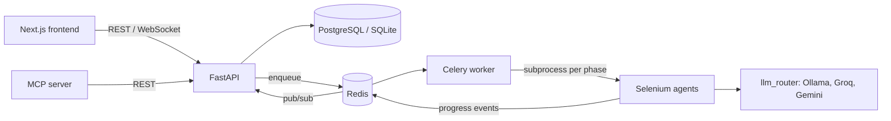

<h1 align="center">JobAgent: AI Job Application Automation</h1>

<p align="center">
Open-source job auto-applier that finds roles, scores fit, tailors your resume per job, fills and submits applications in a real browser, and tracks every outcome. Works with LinkedIn Easy Apply, Internshala, Wellfound, Naukri, Unstop and ATS pages (Lever, Greenhouse, Workday). Includes a Claude MCP server.
</p>

<p align="center">
  <a href="https://frontend-harshs-projects-68f6e57b.vercel.app"><b>Live app</b></a> ·
  <a href="#getting-started">Quick start</a> ·
  <a href="#api-reference">API</a> ·
  <a href="#mcp-server-and-chrome-extension">Claude / MCP</a> ·
  <a href="docs/">Docs</a>
</p>

<p align="center">
  
  
  
  
  
  
  <a href="https://github.com/Hraghuwa/job-autoapplier-ai-latest/stargazers"></a>
</p>

> **Who is it for?** Students and job seekers applying at volume (internships, entry-level and full-time roles) who want quality-gated, tailored applications instead of spray-and-pray. If it saves you time, a star helps others find it.

## Table of contents

1. [Overview](#overview)
2. [Architecture](#architecture)
3. [Getting started](#getting-started)
4. [Agent phases](#agent-phases)
5. [Repository layout](#repository-layout)
6. [API reference](#api-reference)
7. [Module reference](#module-reference)
8. [MCP server and Chrome extension](#mcp-server-and-chrome-extension)
9. [Plans and limits](#plans-and-limits)
10. [Configuration](#configuration)
11. [Testing and CI](#testing-and-ci)
12. [Deployment](#deployment)
13. [Security and responsible use](#security-and-responsible-use)

## Overview

| Capability | Description |
|---|---|
| Discovery | Google search, career-page crawling, public board APIs and JobSpy (LinkedIn, Indeed, Naukri, Google Jobs). |
| Fit gate | Scores each posting against the profile (title, must-have skills, seniority, historical callback rate) and skips weak matches before applying. |
| CV tailoring | Converts a job description into a structured signature and renders an ATS-safe PDF. Every bullet traces to the source profile, so nothing is invented. Results are cached per JD and profile version. |
| Application | LinkedIn Easy Apply, Internshala, Wellfound, Naukri, Unstop, and generic ATS pages (Lever, Greenhouse, Workday). |
| Form filling | Deterministic label rules, then a reusable answer bank, then an LLM fallback. Supports multi-step forms, uploads, Google Forms and Typeform. |
| Tracking | Kanban pipeline, analytics, response rates per resume and archetype, interview prep, follow-up cadence and Gmail-based outcome proposals. |
| Career-Ops | A-G offer evaluation, offer comparison, negotiation scripts, STAR story bank and skill-gap study plans. |
| AI Missions | Scan portals, save target companies, then apply to them one tab at a time. |
| Safeguards | Per-platform rate limits, 90-day dedup, adaptive jittered delays and CAPTCHA detection. |
| Platform | Cron scheduling, knowledge graph, admin console, Razorpay and Stripe billing, Resend email notifications. |

## Architecture



- **Isolation:** each phase runs in its own subprocess (`agents/run_phase_subprocess.py`), so the appliers' module-global config cannot leak between users.
- **Resilience:** `agent_supervisor` starts a worker when none is listening, fails stale runs and exposes `/agents/healthcheck`. Celery Beat evaluates saved cron schedules every 5 minutes.
- **LLM routing:** `llm_router.py` selects a provider per role (`form_fill`, `writer`) and falls back across Ollama, Groq and Gemini. It never raises; callers handle `None` or an empty string.
- **Secrets:** platform credentials are Fernet-encrypted at rest. Scraped text is fenced before it reaches a prompt.

## Getting started

### Run it yourself (Docker, one command)

The easiest way to use JobAgent: your own private copy on your own computer. Your data and job-site logins never leave your machine.

1. Install and open [Docker Desktop](https://www.docker.com/products/docker-desktop/). On Windows, run the commands below in WSL or Git Bash.
2. Get a free Gemini API key at [aistudio.google.com/apikey](https://aistudio.google.com/apikey). You can skip this step, but the AI features need the key.
3. Run:

```bash
git clone https://github.com/Hraghuwa/job-autoapplier-ai-latest.git
cd job-autoapplier-ai-latest
bash setup.sh
```

4. Open **http://localhost:3000** and register. The first account you create is yours, and nobody else can see it.

| Task | Command |
|---|---|
| Stop | `docker compose down` (your data is kept) |
| Start again | `docker compose up -d` |
| Update to latest | `git pull && docker compose up -d --build` |
| See errors | `docker compose logs backend worker` |
| Add/change Gemini key | edit `SYSTEM_GEMINI_KEY` in `backend/.env`, then `docker compose up -d` |
| Delete everything | `docker compose down -v` (permanently deletes your data) |

`setup.sh` generates every secret for you (database password, `SECRET_KEY`, `FERNET_KEY`) and never overwrites an existing `.env`.

### Local development (without Docker)

Prerequisites: Python 3.9+, Node 18+, Redis, Google Chrome.

```bash
bash start.sh
```

This creates `backend/.env`, seeds the database and an admin user, starts Redis, the API (`:8000`), a Celery worker and the frontend (`:3000`).

Manual setup:

```bash
pip install -r requirements.txt
cp backend/.env.example backend/.env       # set SECRET_KEY, FERNET_KEY, GEMINI_API_KEY
python scripts/seed_local.py

uvicorn backend.main:app --port 8000
celery -A backend.workers.celery_app worker -Q agents,default
celery -A backend.workers.celery_app beat  # required for scheduled runs

cd frontend && npm install && npm run dev
```

Typical flow: register, upload a resume under Onboarding, add platform credentials, then start a run from Automation. Without the web app, edit `agents/config.py` and run `python agents/main.py`.

## Agent phases

Started with `POST /agents/run`. Requested phases are filtered by plan and checked for stored credentials.

| Phase | Target | Entry point |
|---|---|---|
| 1 | LinkedIn Easy Apply (session cookies or password) | `run_phase1.py` |
| 2 | Internshala | `orchestrator.run_internshala_phase` |
| 3 | Wellfound | `orchestrator.run_wellfound_phase` |
| 4 | Naukri | `orchestrator.run_naukri_phase` |
| 5 | Unstop | `orchestrator.run_unstop_phase` |
| 6 | Web search (Google, 30+ boards, ATS pages) | `orchestrator.run_web_search_phase` |
| 7 | Fill every open tab | `orchestrator.run_form_fill_phase` |

Pause is cooperative: the subprocess polls a Redis/DB flag and `agent_stop.should_stop()`.

## Repository layout

```
backend/           FastAPI app: routers/, services/, models/, workers/
agents/            Selenium appliers, job finder, form fillers, ContextFill bridge
frontend/          Next.js (App Router), Tailwind, shadcn/ui
mcp_server/        stdio MCP server
chrome_extension/  Manifest V3 auto-fill extension
llm_router.py      Role-based LLM routing with fallback
docs/  tests/  scripts/
```

## API reference

Interactive docs are served at `/docs`. All routes require a JWT bearer token except auth, `/health` and payment webhooks. Live run events stream over `WS /ws/{user_id}`.

| Prefix | Endpoints |
|---|---|
| `/auth` | `POST /register`, `/login`, `/refresh`, `/promote-self`; `GET /me` |
| `/onboarding` | `POST /resume`, `/preferences`, `/credentials`, `/autofill`, `/linkedin-cookies`; `GET /status`, `/credentials-status`, `/linkedin-cookies-status`, `/test/{platform}`; `DELETE /linkedin-cookies` |
| `/agents` | `POST /run`, `/pause/{run_id}`, `/schedule`, `/runs/{run_id}/analyze`; `GET /healthcheck`, `/preflight`, `/status/{run_id}`, `/runs`, `/schedule`, `/runs/{run_id}/logs` |
| `/jobs` | `GET ""`, `/analytics`, `/{id}`, `/{id}/interview-prep`; `PATCH /{id}/status` |
| `/applications` | `GET /response-rates/by-resume`, `/response-rates/by-archetype` |
| `/resumes` | CRUD, `POST /{id}/duplicate`, section CRUD, `PUT /{id}/sections/reorder` |
| `/ai` | `POST /enhance-summary`, `/enhance-bullet`, `/generate-bullets`, `/cover-letter`, `/cover-letter/free-preview`; `GET /health` |
| `/career-ops` | `/evaluate`, `/evaluations`, `/compare`, `/tailor-cv` (`/apply`, `/undo`), `/story-bank`, `/negotiation`, `/scan`, `/mission-targets`, `/project-eval`, `/training-eval`, `/deep-research`, `/patterns`, `/contact-strategy`, `/followup`, `/followups/due`, `/skill-gaps` (`/plan`), `/outcomes/gmail-scan`, `/outcomes/apply`, `/health` |
| `/users` | `GET/PATCH /profile`; `POST/DELETE /gemini-key`, `/groq-key`; `GET /api-keys`, `/usage`, `/quota`, `/referral`; `DELETE /account` |
| `/payments` | `GET /plans`, `/config`; Razorpay `create-order`, `verify`, `webhook`; Stripe `create-session`, `webhook` |
| `/admin` | `GET /users`, `/revenue`, `/agents/active`, `/platform-health`, `/metrics`; `PATCH /users/{id}/plan`; `POST /impersonate/{id}` |
| `/graph`, `/bugs` | Knowledge graph, stats and node positions; bug report and list |

## Module reference

### Backend services (`backend/services/`)

| Module | Responsibility |
|---|---|
| `fit_scorer`, `apply_decision` | Fit scoring and the apply/skip gate; structured job reporting for the worker |
| `jd_analyser` | JD to `JDSignature`, with a hallucination filter and hash-keyed cache |
| `resume_tailor`, `resume_pdf`, `tailored_resume_store`, `resume_resolver` | Tailoring, ATS-safe PDF rendering and parse check, cache, and fallback to the static resume |
| `cover_note` | JD-aware cover note with a reviewer pass and static fallback |
| `rate_limits`, `backoff`, `skiplist` | In-memory or Redis limiter, jittered delays, 90-day dedup |
| `plan_gate` | Plan limits and monthly AI-token metering |
| `followthrough`, `response_rates` | Follow-up cadence, skill gaps, IMAP outcome proposals, callback statistics |
| `agent_supervisor` | Worker lifecycle, stale-run recovery, dependency health check |
| `run_metrics`, `llm_usage` | Per-platform run metrics, per-call token and cost capture |
| `crypto_service`, `untrusted`, `linkedin_cookies` | Fernet encryption, prompt-injection fencing, session cookie handling |
| `gemini_service`, `resume_parser`, `email_service`, `graph_service`, `tracking_service` | Resume parsing and AI helpers, notifications, graph, tracking |

Workers: `workers/agent_tasks.py` (`run_phase_task`, `check_schedules`, quota checks, event classification) and `workers/celery_app.py` (queues, Beat schedule).

### Agents (`agents/`)

| Module | Responsibility |
|---|---|
| `orchestrator` | Phase runners and Chrome driver construction |
| `linkedin_applier` | Cookie/password login, job-card loop, Easy Apply modal, external apply |
| `internshala_applier`, `other_platforms`, `wellfound_applier` | Internshala, Unstop and Naukri, Wellfound |
| `web_search_applier` | Google search, ATS detection (Lever, Greenhouse, Workday, generic), one tab at a time |
| `job_finder`, `jobspy_fetch`, `job_targeting` | Discovery, JobSpy bridge (separate Python 3.10+ interpreter), pre-open posting filter |
| `smart_form_filler`, `google_form_filler` | Field matching and filling, Google Forms, Typeform, generic forms |
| `contextfill_bridge`, `contextfill_page` | LLM-assisted field mapping through ContextFill |
| `agent_vision` | Gemini vision for locating Apply buttons and analysing forms |
| `run_phase_subprocess`, `agent_stop` | Subprocess entry point and pause handling |

### Frontend (`frontend/app/(app)/`)

`dashboard`, `automation`, `jobs` (kanban and detail), `analytics`, `career-ops`, `graph`, `credentials`, `onboarding`, `settings` and `settings/billing`, `admin`. Shared client code: `lib/api.ts` (axios with JWT), `lib/ws.ts` (live events), `lib/auth.ts`.

## MCP server and Chrome extension

`mcp_server/jobagent_mcp.py` exposes JobAgent to Claude over stdio. Authenticate once with `python mcp_server/jobagent_mcp.py login`.

Tools: `get_profile`, `set_job_targets`, `scan_portals`, `save_mission_targets`, `list_mission_targets`, `remove_mission_target`, `tailor_cv`, `apply_cv_tailoring`, `undo_cv_tailoring`, `launch_mission`, `mission_status`, `mission_logs`, `stop_mission`, `list_applications`, `record_outcome`, `interview_prep`, `followups_due`, `draft_followup`, `skill_gaps`, `study_plan`, `evaluate_offer`.

Claude Code commands in `.claude/commands/` (also served as MCP prompts): `job-auto`, `job-setup`, `job-apply`, `job-daily`, `job-weekly`, `job-interview`. Setup guide and the one-line `/job-auto <role>` flow: [docs/MCP_QUICKSTART.md](docs/MCP_QUICKSTART.md).

`chrome_extension/` is a Manifest V3 extension that fills the active tab's application form from a saved profile. Build with `python build_extension.py`.

## Plans and limits

| | Free | Pro | Team |
|---|---|---|---|
| Platforms | LinkedIn | All | All |
| Applies per day | 20 | Unlimited | Unlimited |
| AI tokens per month | 50 | 2,000 | 5,000 |
| Web search, cover letters, scheduling, analytics, kanban | No | Yes | Yes |
| Open tabs | 20 | 100 | 100 |

Pro: INR 499/month or INR 3,999/year (Razorpay); USD 9.99/month or USD 79.99/year (Stripe). Users may supply their own Gemini or Groq key instead of consuming operator tokens.

## Configuration

Settings load from `backend/.env`. Templates: `backend/.env.example`, `.env.prod.example`, `frontend/.env.local.example`.

| Variable | Purpose |
|---|---|
| `DATABASE_URL`, `REDIS_URL` | Database (SQLite for local, PostgreSQL for production) and queue |
| `SECRET_KEY`, `FERNET_KEY` | JWT signing and credential encryption. `SECRET_KEY` is derived from `FERNET_KEY` when unset |
| `GEMINI_API_KEY`, `GROQ_API_KEY`, `OLLAMA_HOST`, `JOBAGENT_LLM_ORDER` | LLM providers and priority |
| `CHROME_BIN`, `CHROMEDRIVER_PATH`, `JOBAGENT_SERVER_MODE` | Browser binary and headless server mode |
| `JOBSPY_PYTHON`, `CONTEXTFILL_DIR` | JobSpy interpreter and ContextFill extension location |
| `JOBAGENT_INPROC_PHASE`, `DISABLE_AGENT_SUPERVISOR`, `AGENT_WORKER_CONCURRENCY`, `AGENT_STALE_TIMEOUT_MIN` | Worker behaviour |
| `ADMIN_BOOTSTRAP_SECRET` | Enables `/auth/promote-self` |

Razorpay, Stripe and Resend credentials are read by the payments router and email service.

## Testing and CI

```bash
pytest tests/                     # backend: API, auth, security, dedup, field mapping, safety gate, payments, career pipeline, browser
cd frontend && npx jest           # frontend
```

GitHub Actions (`.github/workflows/ci.yml`) runs the backend suite and an import check on pull requests and on pushes to `main`.

## Deployment

- **API:** Railway (`Procfile`, `railway.json`, `nixpacks.toml`) or Docker (`docker-compose.prod.yml`, `backend/Dockerfile`).
- **Worker:** `backend/Dockerfile.worker` bundles Chromium and chromedriver. `GET /agents/healthcheck` reports whether selenium and a Chrome binary are present. See [docs/WORKER.md](docs/WORKER.md).
- **Frontend:** Vercel (`frontend/vercel.json`).

Further documentation in [docs/](docs/): [ADR-001](docs/ADR-001-web-search-contextfill.md), [Career-Ops](docs/CAREER_OPS_INTEGRATION.md), [database](docs/DATABASE.md), [Oracle deploy](docs/DEPLOY_ORACLE.md), [concurrency plan](docs/C2_CONCURRENCY_PLAN.md), [system audit](docs/SYSTEM_AUDIT.md). Roadmap: [PLAN.md](PLAN.md), [TODO.md](TODO.md).

## Security and responsible use

- Never commit `.env` files, `config.py` with real credentials, browser profiles or `*.db` files.
- Automated applications may violate a platform's terms of service. Keep rate limits enabled, use your own accounts, and review what is submitted.
- Report vulnerabilities privately to the repository owner rather than in a public issue.
